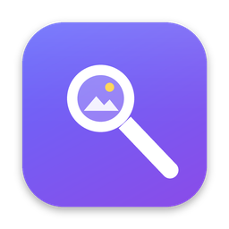

<p align="center">
  
</p>

<h1 align="center">Lupa</h1>

<p align="center">
  <b>Znajdź każdy plik na Macu, opisując go własnymi słowami.</b><br>
  Lokalna, prywatna wyszukiwarka plików oparta na modelu Google <b>EmbeddingGemma 2</b>.
</p>

<p align="center">
  <a href="README.md">🇬🇧 English</a> ·
  <a href="#instalacja">Instalacja</a> ·
  <a href="#funkcje">Funkcje</a> ·
  <a href="docs/SPECYFIKACJA.md">Pełna specyfikacja</a>
</p>

<p align="center">
  
  
  
  
</p>

---

Wpisz *„zdjęcie drużyny na sztucznej murawie”*, *„faktura za transport 2025”* albo *„logo na przezroczystym tle”*, a Lupa znajdzie właściwe pliki, nawet jeśli ich nazwy nic nie mówią. Rozumie treść dokumentów, wygląd obrazów, klatki filmów i dźwięk.

**Nic nie opuszcza Twojego Maca.** Bez chmury, bez konta, bez telemetrii. Internet jest potrzebny tylko raz, do pobrania modelu.

> **Wersja beta.** Lupa działa na co dzień, ale to młody projekt. Zgłoszenia błędów i pull requesty są mile widziane.

## Funkcje

- 🔎 **Szukanie po znaczeniu:** semantyczne i po słowach kluczowych, w nazwach, folderach, treści dokumentów, obrazach, klatkach wideo i audio.
- 🖼️ **Dla wzrokowców:** duże miniatury, szybki podgląd, pełny ekran (←/→), filmy odtwarzane po najechaniu i przewijane do pasującego momentu.
- 📂 **Przeglądarka folderów:** chodzisz po folderach jak w Finderze, z miniaturami zawartości każdego folderu (działa też przy wyłączonym NAS-ie).
- 🎨 **Szukanie po kolorze:** wybierasz kolor i dostajesz obrazy, projekty i filmy w tym kolorze; działa też w połączeniu z zapytaniem.
- 🧲 **Szukanie obrazem:** przeciągnij lub wklej zdjęcie, żeby znaleźć podobne. Przycisk **„Podobne”** działa dla każdego pliku.
- 🏷️ **Tagi i kolekcje:** kolorowe tagi (także dla wielu plików naraz), ulubione i zapisane wyszukiwania.
- 🎛️ **Filtry i sortowanie:** typ, format (PSD, TIFF, Affinity, AI, SVG), data, dysk, skróty folderów (Pobrane, Biurko, Dokumenty, iCloud Drive), tagi.
- 🧹 **Porządki:** odzyskiwanie miejsca na dysku Maca. Lupa znajduje cache, logi, stare instalatory, resztki po odinstalowanych aplikacjach, identyczne duplikaty, nieużywane aplikacje i duże stare pliki, a zaznaczone przenosi do Kosza (zawsze da się je przywrócić).
- 🗄️ **Obsługa NAS:** indeks i miniatury zostają lokalnie, więc przeglądanie działa nawet przy odłączonym dysku sieciowym.
- ✨ **Zapytaj swoje pliki:** pytasz własnymi słowami, a lokalna Gemma (Ollama) odpowiada wyłącznie na podstawie Twoich dokumentów i podaje klikalne źródła.
- 🔤 **OCR:** tekst ze skanów PDF, zrzutów ekranu i zdjęć dokumentów jest wyszukiwalny (Apple Vision, po polsku, na urządzeniu).
- 🎙 **Transkrypcje:** mowa z nagrań i filmów jest przepisywana lokalnie (Whisper) i wyszukiwalna. Kliknięcie zdania przewija nagranie do tego miejsca.
- ✂️ **Usuń tło:** jedno kliknięcie w podglądzie tworzy obok kopię `<nazwa> bez tła.png`. Przy logotypach na jednolitym tle Lupa usuwa też tło w środku liter (O, A, B…), a zachowuje białe elementy logo, np. biały napis na ciemnej plakietce, i nie zostawia obwódki. Przy zdjęciach, ludziach i produktach używa otwartego modelu AI BiRefNet (najlepsze krawędzie włosów i sierści, pobierany raz, ok. 450 MB, zwalnia pamięć po 5 minutach bezczynności), a dopóki go nie pobierzesz - Apple Vision. Wynik możesz zostawić jako kopię albo zastąpić nim oryginał (oryginał trafia do Kosza).
- 🗜 **Kompresja i konwersja obrazów:** PNG, JPG, WebP, AVIF, HEIC i TIFF, dla jednego pliku albo całego zaznaczenia: jakość, maksymalny rozmiar, PNG w 256 kolorach (jak TinyPNG), usuwanie danych EXIF i GPS. Kopia obok oryginału albo zastąpienie oryginału (oryginał trafia do Kosza).
- ✏️ **Prosty edytor zdjęć:** w podglądzie (albo klawisz `E`): kadrowanie dowolne lub w proporcjach (1:1, 4:3, 16:9, 9:16, 4:5…), obrót, odbicie, jasność, kontrast i nasycenie. Kopia obok oryginału albo zastąpienie oryginału (oryginał trafia do Kosza).
- 🏷 **Podpowiedzi tagów:** Lupa uczy się z Twoich tagów i proponuje je nowym plikom.
- 🍏 **Natywna aplikacja:** ikona w Docku, autostart, tryb jasny i ciemny. **⌥⌘L** w dowolnym miejscu otwiera mini okno jak Spotlight (↵ otwórz, ⌘↵ Finder, ⌘Y podgląd, ⌘O pełne okno, przeciągnij wynik do innej aplikacji).
- 🧩 **Rozszerzenie Raycast** w [`raycast-extension/`](raycast-extension/): siatka miniatur, filtr typu, Quick Look, podobne pliki, kopiowanie pliku. Instalacja: `cd raycast-extension && npm install && npm run dev`.
- 🗺 **Mapa dysku:** mapa kafelkowa tego, co zajmuje miejsce na Macu (na żywo) i na NAS-ie (z indeksu), z wchodzeniem w foldery.
- ⌨️ **Skróty:** `/` szukaj · strzałki · `Spacja` podgląd · `Q` pełny ekran · `Enter` otwórz · `⌘Enter` pokaż w Finderze · `S` podobne · `T` taguj · `F` ulubione.

## Wymagania

- macOS 13+, zalecany **Apple Silicon** (na Macu z procesorem Intel też działa, ale wolniej).
- Około **3 GB** wolnego miejsca (model 1,4 GB + biblioteki 1,2 GB) plus miejsce na indeks.
- [Homebrew](https://brew.sh) i Xcode Command Line Tools. Instalator sam doinstaluje `uv` i `ffmpeg`.
- Zalecane 16 GB RAM.

## Instalacja

```bash
git clone https://github.com/Smart-Pixel-PL/lupa-search.git
cd lupa-search
./install.sh
```

Możesz też pobrać ZIP (zielony przycisk **Code**), rozpakować go i uruchomić `./install.sh` w rozpakowanym folderze.

**Na koniec nadaj Lupie dostęp do plików:** *Ustawienia systemowe → Prywatność i ochrona → **Pełny dostęp do dysku*** → ＋ → **Lupa**. Potem zamknij Lupę (⌘Q) i otwórz ją ponownie.

> Nie usuwaj folderu projektu po instalacji, bo Lupa.app uruchamia z niego swój silnik.

Odinstalowanie: `./uninstall.sh`

## Użytkowanie

Otwórz **Lupę** z Launchpada albo naciśnij **⌥⌘L**. Pierwsze indeksowanie rusza samo: najpierw skan i nazwy (po kilku minutach wszystko da się znaleźć po nazwie), potem miniatury, a na końcu analiza treści, która przy dużych zbiorach trwa kilka godzin. Indeksowanie działa z najniższym priorytetem systemowym, więc nie spowalnia pracy na Macu. Po restarcie wznawia pracę od miejsca, w którym stanęło, dyski sieciowe skanuje najwyżej raz w tygodniu, a na baterii wstrzymuje analizę. Można je też wstrzymać w lewym dolnym rogu.

Konfiguracja jest w pliku `lupa.toml` w folderze projektu (powstaje z [`lupa.example.toml`](lupa.example.toml)). Ustawisz w nim foldery do indeksowania (np. dysk sieciowy `"/Volumes/NAS"`), skróty folderów, wykluczenia i jakość analizy obrazów.

## Porządki

Zakładka do utrzymania porządku na **dysku lokalnym**. Pliki systemowe macOS, pęk kluczy, Poczta, Wiadomości i iCloud Drive są nietykalne, a dyski sieciowe są pomijane. Przycisk **„Odinstaluj aplikację…”** działa jak w Raycaście: pokazuje wszystkie pliki aplikacji, także systemowe (`LaunchDaemons`, `PrivilegedHelperTools`), z polami wyboru i rozmiarami, a pliki systemowe usuwa po podaniu hasła. Nieużywane aplikacje są **prawidłowo odinstalowywane**: aplikacja trafia do Kosza razem ze swoimi danymi z `~/Library`. Aplikacje Adobe Lupa odsyła do Creative Cloud, a aplikacje z własnym deinstalatorem albo z komponentami systemowymi do deinstalatora producenta. Kategoria **„Już są na NAS-ie”** pokazuje pliki z Maca, których identyczna kopia (nazwa, rozmiar i suma kontrolna) leży już na NAS-ie — usuwasz tylko lokalną, a kopia jest sprawdzana jeszcze raz tuż przed przeniesieniem do Kosza. Każda pozycja ma poziom ryzyka (bezpieczne / sprawdź / uważaj). Lupa niczego nie kasuje sama: zaznaczone elementy trafiają do Kosza przez Findera. Skan uruchamia się co tydzień, a przy wolnym miejscu poniżej 15% przychodzi powiadomienie. Opcjonalnie Lupa może co tydzień sama przenosić do Kosza cache i logi. Szczegóły są w [specyfikacji](docs/SPECYFIKACJA.md#9-porządki--czyszczenie-dysku-lokalnego).

## Technologia w skrócie

- **Model:** [`google/embeddinggemma-2`](https://huggingface.co/google/embeddinggemma-2), 740 mln parametrów, Apache 2.0, ponad 100 języków.
- **Silnik:** Python, FastAPI, SQLite (FTS5), NumPy, PyTorch na GPU Apple (MPS).
- **Aplikacja:** Swift i WebKit.

Szczegóły znajdziesz w [specyfikacji](docs/SPECYFIKACJA.md).

## Licencja

[MIT](LICENSE) © Smart Pixel. Model EmbeddingGemma 2 © Google, licencja Apache 2.0.
